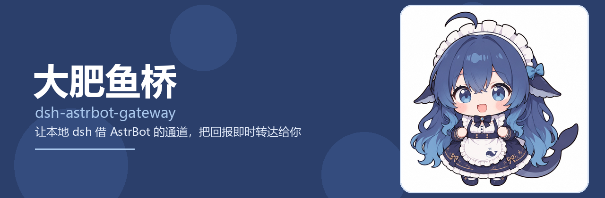

<div align="center">



# dsh-astrbot-gateway

_✨ 大肥鱼桥 · 让本地 AI 智能体借 AstrBot 的通道和用户说话 ✨_

[](https://opensource.org/licenses/MIT)
[](https://github.com/AstrBotDevs/AstrBot)
[](https://github.com/qzy033/dsh-astrbot-gateway)
[](https://github.com/qzy033/astrbot_plugin_dsh_gateway)
[](https://www.npmjs.com/package/dsh-astrbot-gateway)

</div>

---

## 版本记录

| 版本 | 时间 | 要点 |
| --- | --- | --- |
| v0.7.0 | 2026-11-07 | 修 AstrBot 4.26+ 兼容（issue #1：`send_message_by_id` 被上游删除）；收编直通模式（`dsh/1` 原文进出）；DSH 侧会话复用；文档重写成不用 AI 也能装 |
| v0.6.1 | 2026-09-13 | npm 包补 dsh-plugin 关键字，1024 商店能识别 npm 安装；两侧版本对齐 |
| v0.6.0 | 2026-09-13 | 闸门改叫醒机制：消息先落中转箱，三秒内叫醒助手，由助手自己转达；插件本体扶正到独立仓库；安装文档重写成完整上手手册 |
| v0.5.0 | 2026-09-12 | 首个公开版本：两侧插件与 npm 包首发，配置项带默认值，可独立安装 |

让本地 AI 智能体（DeepSeek Harness / DSH 等）通过 **AstrBot** 的通道和用户对话。

智能体不再拥有直接给用户发消息的能力：它说的话一律先落进中转箱，AstrBot 侧插件随即在三秒内把那位助手叫醒，由助手自己读中转件、用自己的话讲出来。用户说的话，也先由 AstrBot 侧确认是给它的才放行。

```
┌──────────┐  ① 指令   ┌────────────────┐  ② 拉会话  ┌──────────────┐
│   用户   │ ────────▶ │ AstrBot 侧闸门 │ ────────▶ │  本地智能体  │
│ （聊天） │ ◀──────── │  （唯一出口）  │ ◀──────── │     dsh      │
└──────────┘  ④ 转达   └────────────────┘  ③ 回报   └──────────────┘
                            ▲                            │
                            └──── cache/dsh_relay ◀──────┘
                                 （中转箱，唯一通道）
```

## 两个仓库

这个项目有两半，分别住在两个仓库里。**不是 fork，也不是子模块**，是同一套东西的两侧：

| 仓库 | 放什么 | 装到哪 | 本地目录 |
| --- | --- | --- | --- |
| **本仓库** [qzy033/dsh-astrbot-gateway](https://github.com/qzy033/dsh-astrbot-gateway) | DSH 侧插件（npm 包 `dsh-astrbot-gateway`）+ 全部文档 + 工具 | DSH 的 profile | `E:\project\dsh-funa-bridge` |
| **配套仓库** [qzy033/astrbot_plugin_dsh_gateway](https://github.com/qzy033/astrbot_plugin_dsh_gateway) | AstrBot 侧插件本体（**仓库根目录就是插件**） | AstrBot 面板 → 插件管理 | `E:\project\astrbot_plugin_dsh_gateway` |

为什么必须两个仓库：AstrBot 从仓库装插件时要求**仓库根目录**有 `metadata.yaml`，而本仓库根目录放的是 DSH 侧项目本体（`plugin/`、`docs/` 等），两者无法塞进同一个根。所以 AstrBot 侧单独成库，市场才能收录。

两边只通过同一个桥接目录（`cache/`）和本机 HTTP 接口对接，**谁先装、谁后装都不会报错**。
本仓库里的 `astrbot-plugin/` 只保留一份指针说明（2026-11-07 起），**不再放源码，也不要在那里改代码**。

## 安装（不用 AI，照着做就行）

完整手册在 **[docs/install.md](docs/install.md)**（含每一步「你应该看到什么」、排错表、卸载）。
最短路径三步：

### 第 1 步：AstrBot 侧

1. 打开 AstrBot 面板 → 插件管理 → 插件市场，搜 `astrbot_plugin_dsh_gateway` 安装并启用；
   市场里还没有时：插件管理 → 安装插件 → 仓库地址填
   `https://github.com/qzy033/astrbot_plugin_dsh_gateway`（干净地址，不带 `/tree/...`）。
2. 打开插件配置，填「转达目标账号」：私聊填 QQ 号，群聊填群号并把消息类型改成群聊。
3. 「桥接项目目录」留空即可（默认 `<用户主目录>/dsh-astrbot-gateway`），DSH 侧会自动对齐。
4. 重载插件，浏览器打开 `http://127.0.0.1:6185/api/plug/astrbot_plugin_dsh_gateway/ping`，
   看到 `pong` 就通了。端口以面板实际端口为准，插件日志里也会打出这个地址。

### 第 2 步：DSH 侧

先确认 `node` 与 `pnpm` 可用（`pnpm -v` 有版本号），然后二选一：

**A. 从 npm 装（推荐）**

在 DSH 的 profile 目录（`%USERPROFILE%\.dsh\profiles\<你的 profile>`，桌面端通常是 `desktop`）里：

```powershell
pnpm add dsh-astrbot-gateway@0.7.0
```

> 发布状态以 `npm view dsh-astrbot-gateway version` 为准。如果 npm 上还没到 0.7.0（发布要登录 npm），
> 先用下面的方式 B 从仓库源码装，功能与 npm 版一致。

再把 `"dsh-astrbot-gateway"` 加进该 profile `package.json` 的 `dsh.profile.bundles` 数组。

**B. 用仓库里的安装脚本**

```powershell
cd plugin\dsh-astrbot-gateway
powershell -ExecutionPolicy Bypass -File tools\install.ps1 -Apply `
  -ProfileDir "$env:USERPROFILE\.dsh\profiles\desktop"
```

脚本会先跑离线自测、检查 profile 冲突，再登记依赖和 bundles；默认是 dry-run，加 `-Apply` 才写入。

然后编辑该 profile 的 `cordis.patch.yml`，**按 id 覆盖配置**（不要写 `insert`，否则同一个 id 会被插两次）：

```yaml
- id: dsh-astrbot-gateway
  config:
    root: C:\Users\你的用户名\dsh-astrbot-gateway\cache
    autoDispatch: true
    dispatchCwd: C:\Users\你的用户名\dsh-astrbot-gateway
    dispatchPreset: standard
    dispatchPromptFile: C:\Users\你的用户名\dsh-astrbot-gateway\config\dispatch-prompt.md
    uplinkMode: off
```

> 为什么不能写 `insert`：这个包是 bundle 插件，进了 `dsh.profile.bundles` 就已经被插入一次；
> 再在 profile patch 里 `insert` 同一个 id，DSH 启动会报
> `duplicate loader entry id "dsh-astrbot-gateway"` 并进恢复模式。

**重启 DSH**（bundle 插件 + ESM 缓存，必须重启才加载）。

### 第 3 步：自检

| 看什么 | 正常的样子 |
| --- | --- |
| `GET /api/plug/astrbot_plugin_dsh_gateway/ping` | 返回 `pong` |
| `<桥接目录>/cache/bridge_access.json` | 有 `base_url`、`token` 和三个接口地址 |
| `<桥接目录>/cache/bridge_status.json` | `poller` 不是 `none`，`autodispatch` 是 `true`，`dispatch.reuseSession` 是 `true` |
| DSH 日志 | 有 `[dsh-gateway]` 开头的启动行，且没有报错 |

只装一侧也不会报错：两边都不写死对方的地址，一边只认目录和文件，另一边只认本机 HTTP 接口。

## 直通模式（v0.7.0）

平时每句话都要过闸门：助手先判断、再总结、再转述。要连着跟 DSH 来回聊时，主人可以在私聊里把这道闸门暂时撤掉：

| 指令 | 作用 |
| --- | --- |
| `dsh/1` | 进直通：之后你说的话原文直送 DSH，DSH 的回话原文转回，不总结、不叫醒助手 |
| `dsh/0` | 退直通：回到原来的闸门模式 |
| `dsh/2` | 换会话：直通还开着，但下一条起换一条全新的 DSH 会话 |

三条指令只在私聊里认、只认配置里的 `target_id`；指令本身不会落进对话，也不会被当成任务投给 DSH。
开关状态写在 `cache/direct_state.json`，AstrBot 重启也认得。详见 [docs/message-rules.md](docs/message-rules.md) 第五节。

## 工作流程

1. 用户在聊天里说要给智能体的话，AstrBot 侧先判断是不是给它的，是就投进收件箱；
2. DSH 侧插件发现新指令，按指令点名的模式拉起会话执行（默认复用上一条会话，上下文不断）；
3. 执行完写回发件箱，同时把同一份结果推给中转箱；
4. AstrBot 侧三秒内把助手叫醒，由助手自己读中转件、用自己的话讲给用户，讲完归档。

任务完成一定会回报，不需要用户追问。

## 文档导航

| 想知道什么 | 看哪份 |
| --- | --- |
| 从零安装、验收、卸载 | [docs/install.md](docs/install.md) |
| AstrBot 侧怎么装、四项直通配置 | [docs/install-astrbot.md](docs/install-astrbot.md) |
| DSH 侧怎么装、profile 怎么改 | [docs/install-dsh.md](docs/install-dsh.md) |
| 出问题了先查哪 | [docs/troubleshooting.md](docs/troubleshooting.md) |
| 消息字段、直通规则 | [docs/message-rules.md](docs/message-rules.md) |
| 为什么这么设计 | [docs/bridge-design.md](docs/bridge-design.md) |
| 项目地图、两仓库关系、环境快照 | [docs/PROJECT-MEMORY.md](docs/PROJECT-MEMORY.md) |
| 本次 v0.7.0 计划与执行清单 | [docs/PLAN-v0.7.0.md](docs/PLAN-v0.7.0.md) |
| 提交插件市场怎么填 | [docs/market-submit.md](docs/market-submit.md) |

## 安全说明

- `cache/` 里的 `bridge_access.json` 含自签令牌，**已在 .gitignore 中排除**，切勿提交或外传；
- AstrBot 的接口只绑定回环地址，请勿把端口暴露到公网；
- 本地智能体具备本机文件读写与命令执行能力，等同于授权它操作电脑，请只在可信环境启用。

## 许可

MIT，见 LICENSE。
